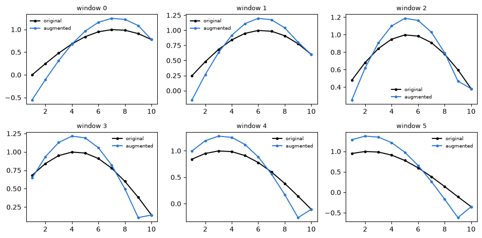

# Data augmentation -- Shrink (`TsAugShrink`)

**About the technique**

* `TsAugShrink` scales the within-window deviations down (dampens variation; the target is kept).
* Every augmenter is a `DalTransform` over the full window and, by default, stacks the original windows on top of the augmented ones (native; no new dependency).

**Didactic goal:** add lower-variance variants.


```python
import warnings
warnings.filterwarnings("ignore")

import pytspredit as ts

windows = ts.ts_data(ts.datasets.tsd()["y"], 10)
print("original windows:", windows.shape)
```

    original windows: (32, 10)


Visualize the series used in this example:


```python
_d = ts.datasets.tsd()
ts.plot_ts(x=_d["x"], y=_d["y"])
```


```python
out = ts.TsAugShrink(scale_factor=0.8).fit(windows).transform(windows)
print('after augmentation:', out.shape)
ts.ts_head(out, 3)
```

    after augmentation: (64, 10)


             t9        t8        t7        t6        t5        t4        t3        t2        t1        t0
    0  0.000000  0.247404  0.479426  0.681639  0.841471  0.948985  0.997495  0.983986  0.909297  0.778073
    1  0.247404  0.479426  0.681639  0.841471  0.948985  0.997495  0.983986  0.909297  0.778073  0.598472
    2  0.479426  0.681639  0.841471  0.948985  0.997495  0.983986  0.909297  0.778073  0.598472  0.381661


Compare a few source windows with their augmented versions on the lag axis (original vs augmented):


```python
import numpy as np
import matplotlib.pyplot as plt

nrow = len(windows)
idx = out.attrs["idx"]
sw = windows.shape[1]
rows = list(range(nrow, min(out.shape[0], nrow + 6)))   # a few augmented windows
fig, axes = plt.subplots(2, 3, figsize=(10, 5), squeeze=False)
for ax, row_id in zip(axes.ravel(), rows):
    src = int(idx[row_id])
    lags = np.arange(1, sw + 1)
    ax.plot(lags, windows.iloc[src].to_numpy(), "-o", ms=3, color="black", label="original")
    ax.plot(lags, out.iloc[row_id].to_numpy(), "-o", ms=3, color="#2a78d6", label="augmented")
    ax.set_title(f"window {src}", fontsize=9)
    ax.legend(fontsize=7, frameon=False)
for ax in axes.ravel()[len(rows):]:
    ax.axis("off")
fig.tight_layout()
fig
```





> **What to observe.** The output stacks the original and the augmented windows (roughly double the rows); it plugs into `TsIntegtune`'s augmentation slot.

**References:** Wen, Q. et al. (2021). *Time Series Data Augmentation for Deep Learning: A Survey.* IJCAI.
