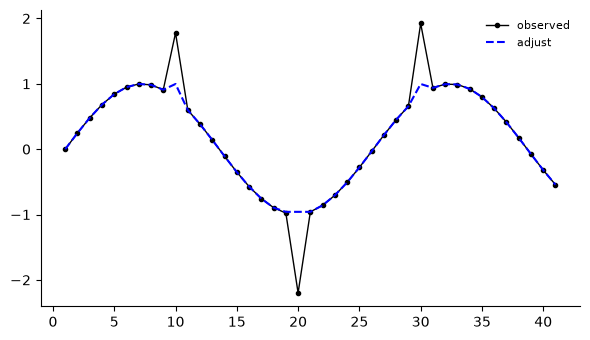

# Custom filter

**About the technique**

* A filter is a `pydaltoolbox.DalTransform` over a 1-D series: implement `fit` (learn any
  parameters) and `transform` (return the filtered series, same length).

**Didactic goal:** write your own preprocessing filter that drops into the pipeline.


```python
import warnings
warnings.filterwarnings("ignore")

import numpy as np
from pydaltoolbox import DalTransform
import pytspredit as ts

class MyClipFilter(DalTransform):
    """Clip the series to its 5th-95th percentile range."""
    def fit(self, data=None, **kwargs):
        x = np.asarray(data, float)
        self.lo, self.hi = np.percentile(x, 5), np.percentile(x, 95)
        return self
    def transform(self, data, **kwargs):
        return np.clip(np.asarray(data, float), self.lo, self.hi)
```


```python
y = ts.datasets.tsd()["y"].to_numpy()
y[[9, 19, 29]] += np.array([1.0, -1.2, 1.1])   # inject spikes the clip filter will tame
f = MyClipFilter().fit(y)
np.round(f.transform(y)[:6], 3)
```


    array([0.   , 0.247, 0.479, 0.682, 0.841, 0.949])


Compare the original series with the filtered one:


```python
ts.plot_ts_pred(y=y, yadj=f.transform(y))
```





> **What to observe.** The same `fit`/`transform` contract as the built-in `TsFil*`
> filters, so your filter can be used anywhere one is expected.

**References:** Salles et al. (2023), *TSPredIT*, LNCS 14160 (Experiment Line extensibility).
