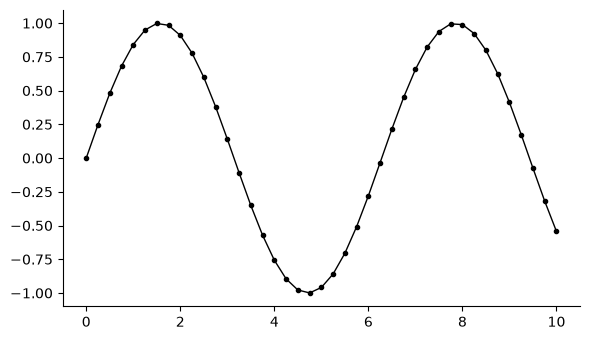

# Synthetic example series (`tsd`) (`datasets.tsd`)

**About the dataset**

* `datasets.tsd()` returns the Eidolon **miniature** -- a data frame (one column per series / interval) -- numerically identical to the R package. The full artifact is resolved on demand with `datasets.loadfulldata`.

**Didactic goal:** load and inspect the dataset's structure.


```python
import warnings
warnings.filterwarnings("ignore")

import pytspredit as ts
```


```python
d = ts.datasets.tsd()
print("shape:", d.shape)
d.head(3)
```

    shape: (41, 2)


          x         y
    0  0.00  0.000000
    1  0.25  0.247404
    2  0.50  0.479426


Visualize the series:


```python
ts.plot_ts(x=d["x"], y=d["y"])
```





> **What to observe.** The miniature preserves the schema of the full dataset (same columns/keys); use `loadfulldata` to fetch the complete series.

**References:** Salles et al. (2023), *TSPredIT*, LNCS 14160.
