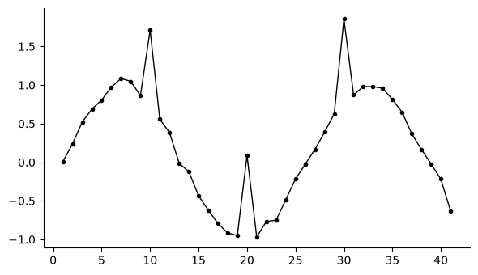
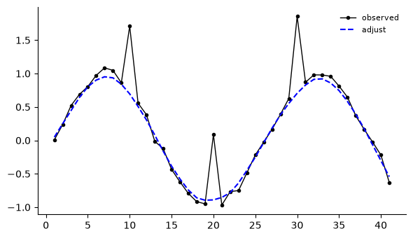

# Filter -- LOWESS (`TsFilLowess`)

**About the technique**

* `TsFilLowess` locally weighted regression smoothing (robust local polynomial fit).
* A filter is a `DalTransform` taking a 1-D series and returning a filtered series of the same length.

**Didactic goal:** see how the filter cleans the raw series before modeling.


```python
import warnings
warnings.filterwarnings("ignore")

import numpy as np
import pytspredit as ts

_rng = np.random.default_rng(0)
_base = ts.datasets.tsd()["y"].to_numpy()
y = _base + _rng.normal(0, _base.std(ddof=1) / 10, len(_base))  # add noise
_spike = _rng.normal(0, _base.std(ddof=1))
y[[9, 19, 29]] += _spike                                        # inject a few spikes
```

Visualize the raw series:


```python
ts.plot_ts(y=y)
```





```python
out = ts.TsFilLowess().fit(y).transform(y)
print('first values:', np.round(out[:6], 3))
print('length:', len(out))
```

    first values: [0.049 0.25  0.447 0.643 0.803 0.902]
    length: 41


Compare the original series with the filtered one:


```python
ts.plot_ts_pred(y=y, yadj=out)
```





> **What to observe.** The filtered series has the same length as the input; apply it as a preprocessing step before the sliding-window model.

**References:** Cleveland, W. S. (1979). Robust locally weighted regression and smoothing scatterplots. JASA, 74(368), 829-836.
