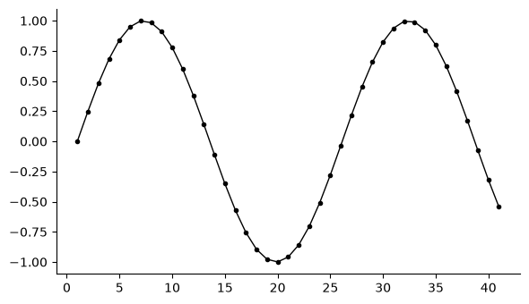
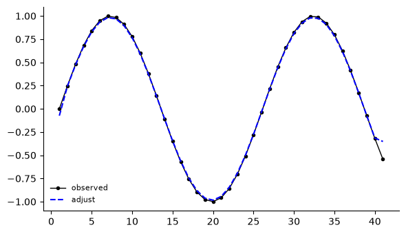

# Filter -- Wavelet (MODWT) (`TsFilWavelet`)

**About the technique**

* `TsFilWavelet` denoises via the native MODWT (removes the finest detail). Native numpy, no dependency.
* A filter is a `DalTransform` taking a 1-D series and returning a filtered series of the same length.

**Didactic goal:** see how the filter cleans the raw series before modeling.


```python
import warnings
warnings.filterwarnings("ignore")

import numpy as np
import pytspredit as ts

y = ts.datasets.tsd()["y"].to_numpy()
```

Visualize the raw series:


```python
ts.plot_ts(y=y)
```





```python
out = ts.TsFilWavelet("haar").fit(y).transform(y)
print('first values:', np.round(out[:6], 3))
print('length:', len(out))
```

    first values: [-0.074  0.244  0.472  0.671  0.828  0.934]
    length: 41


Compare the original series with the filtered one:


```python
ts.plot_ts_pred(y=y, yadj=out)
```





> **What to observe.** The filtered series has the same length as the input; apply it as a preprocessing step before the sliding-window model.

**References:** Mallat, S. (1989), IEEE TPAMI 11(7); Percival & Walden (2000), *Wavelet Methods for Time Series Analysis*, Cambridge.
