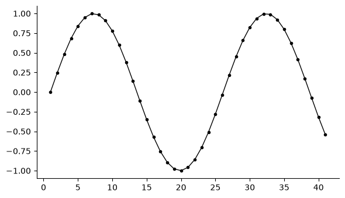
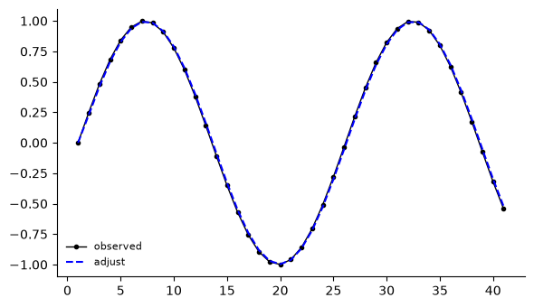

# Filter -- Kalman (local level) (`TsFilKalman`)

**About the technique**

* `TsFilKalman` smooths with a local-level Kalman filter (diffuse init).
* A filter is a `DalTransform` taking a 1-D series and returning a filtered series of the same length.

**Didactic goal:** see how the filter cleans the raw series before modeling.


```python
import warnings
warnings.filterwarnings("ignore")

import numpy as np
import pytspredit as ts

y = ts.datasets.tsd()["y"].to_numpy()
```

Visualize the raw series:


```python
ts.plot_ts(y=y)
```





```python
out = ts.TsFilKalman().fit(y).transform(y)
print('first values:', np.round(out[:6], 3))
print('length:', len(out))
```

    first values: [0.    0.227 0.458 0.663 0.826 0.939]
    length: 41


Compare the original series with the filtered one:


```python
ts.plot_ts_pred(y=y, yadj=out)
```





> **What to observe.** The filtered series has the same length as the input; apply it as a preprocessing step before the sliding-window model.

**References:** Kalman, R. E. (1960). A new approach to linear filtering and prediction problems. J. Basic Engineering, 82(1), 35-45.
