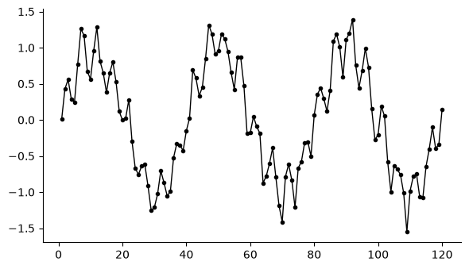
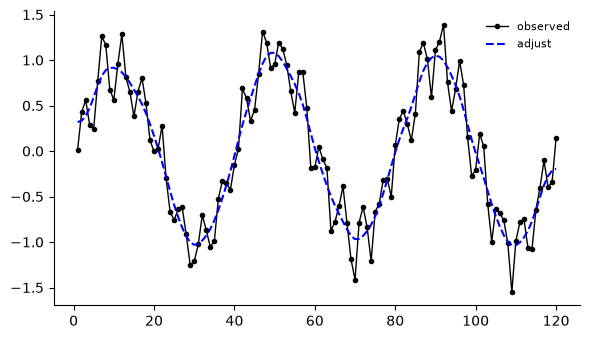

# Filter -- Gabor (`TsFilGabor`)

**About the technique**

* `TsFilGabor` convolves with a Gabor kernel (Gaussian-modulated band-pass). Native kernel.
* A filter is a `DalTransform` taking a 1-D series and returning a filtered series of the same length.

**Didactic goal:** see how the filter cleans the raw series before modeling.


```python
import warnings
warnings.filterwarnings("ignore")

import numpy as np
import pytspredit as ts

_rng = np.random.default_rng(0)
x = np.linspace(0, 6 * np.pi, 120)
y = np.sin(x) + 0.3 * np.sin(8 * x) + _rng.normal(0, 0.12, 120)   # noisy dual-frequency
```

Visualize the raw series:


```python
ts.plot_ts(y=y)
```





```python
out = ts.TsFilGabor(window_size=3, central_frequency=0.05).fit(y).transform(y)
print('first values:', np.round(out[:6], 3))
print('length:', len(out))
```

    first values: [0.318 0.334 0.385 0.475 0.594 0.72 ]
    length: 120


Compare the original series with the filtered one:


```python
ts.plot_ts_pred(y=y, yadj=out)
```





> **What to observe.** The filtered series has the same length as the input; apply it as a preprocessing step before the sliding-window model.

**References:** Gabor, D. (1946). Theory of communication. Journal of the IEE, 93(26), 429-457.
