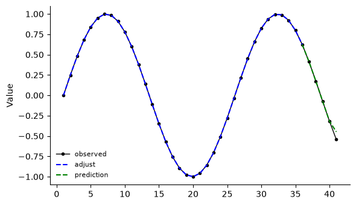

# Multivariate linear regression (`TsLmMv`)

**About the technique**

* `TsLmMv` regresses the target on the synchronized auxiliaries. With a formula it uses
  known future auxiliaries; with `models_x` it forecasts the auxiliaries first.
* Every multivariate `predict` returns the target `y` forecast (the full system is available too).

**Didactic goal:** forecast the target from aligned covariates with a linear model.


```python
import warnings
warnings.filterwarnings("ignore")

import numpy as np
import pandas as pd
import pytspredit as ts

# canonical multivariate data from tsd: y = sine, x1 = y shifted one step,
# x2 = 3-point moving average of y (as in the R examples).
y = ts.datasets.tsd()["y"].to_numpy()
x1 = np.concatenate([y[1:], y[-1:]])
x2 = pd.Series(y).rolling(3).mean().to_numpy()
m = np.isnan(x2); x2[m] = y[m]
mv = ts.ts_data_mv(pd.DataFrame({"y": y, "x1": x1, "x2": x2}), y="y")
samp = ts.ts_sample(mv, test_size=5)
```


```python
lm = ts.TsLmMv(formula="y ~ x1 + x2").fit(samp.train)
np.asarray(lm.predict(samp.test, steps_ahead=5)).round(4)
```


    array([ 0.4116,  0.174 , -0.0748, -0.3194, -0.4489])


Plot the multivariate forecast for the target variable:


```python
pred = lm.predict(samp.test, steps_ahead=5)
ts.plot_ts_pred_mv(samp.train, samp.test, pred, variable="y")
```





> **What to observe.** With known future auxiliaries the fit reproduces R's `lm` (exact); otherwise auxiliaries are modeled.

**References:** Montgomery, Peck & Vining (2012), *Introduction to Linear Regression Analysis*, Wiley; Salles et al. (2023), *TSPredIT*, LNCS 14160.
