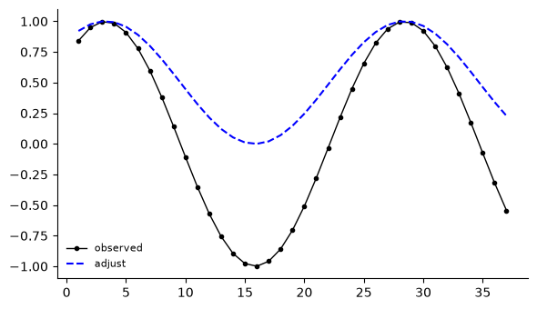

# Global min-max normalization (`TsNormGminmax`)

**About the technique**

* `TsNormGminmax` rescales every window with a **single global** min and max learned
  from the training data, mapping values into `[0, 1]`.

**Didactic goal:** put all windows on one common scale (good for distance/gradient
models) while keeping the transform invertible.


```python
import warnings
warnings.filterwarnings("ignore")

import pytspredit as ts

y = ts.datasets.tsd()["y"]
w = ts.ts_data(y, 5)
```

Visualize the series used in this example:


```python
_d = ts.datasets.tsd()
ts.plot_ts(x=_d["x"], y=_d["y"])
```


```python
norm = ts.TsNormGminmax().fit(w)
t = norm.transform(w)
ts.ts_head(t)
```


             t4        t3        t2        t1        t0
    0  0.500450  0.624351  0.740549  0.841818  0.921863
    1  0.624351  0.740549  0.841818  0.921863  0.975706
    2  0.740549  0.841818  0.921863  0.975706  1.000000
    3  0.841818  0.921863  0.975706  1.000000  0.993235
    4  0.921863  0.975706  1.000000  0.993235  0.955830
    5  0.975706  1.000000  0.993235  0.955830  0.890113


The transform is invertible (recovers the original windows).


```python
ts.ts_head(norm.inverse_transform(t))
```


                 t4        t3        t2        t1        t0
    0 -1.110223e-16  0.247404  0.479426  0.681639  0.841471
    1  2.474040e-01  0.479426  0.681639  0.841471  0.948985
    2  4.794255e-01  0.681639  0.841471  0.948985  0.997495
    3  6.816388e-01  0.841471  0.948985  0.997495  0.983986
    4  8.414710e-01  0.948985  0.997495  0.983986  0.909297
    5  9.489846e-01  0.997495  0.983986  0.909297  0.778073


Compare the original and normalized target (`t0`) columns (solid = original, dashed = normalized):


```python
ts.plot_ts_pred(y=w.iloc[:, -1].to_numpy(), yadj=t.iloc[:, -1].to_numpy())
```





> **What to observe.** All columns share one global `[0, 1]` scale; `inverse_transform`
> returns the original values.

**References:** Salles et al. (2023), *TSPredIT*, LNCS 14160.
