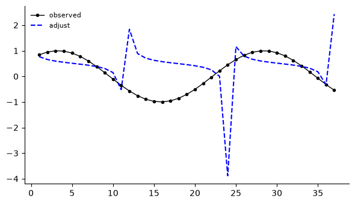

# Adaptive normalization (`TsNormAn`)

**About the technique**

* `TsNormAn` (Adaptive Normalization) centers each window by a local average and
  rescales it by a local scale, through one of four operators. The default,
  `operation="divide"`, divides by the (outlier-robust) window average.
* An outlier step (`OutliersBoxplot` by default) is applied before estimating the
  range, which is decisive for the division operator.

**Didactic goal:** normalize non-stationary series per window with a robust, invertible
transform.


```python
import warnings
warnings.filterwarnings("ignore")

import pytspredit as ts

y = ts.datasets.tsd()["y"]
w = ts.ts_data(y, 5)
```

Visualize the series used in this example:


```python
_d = ts.datasets.tsd()
ts.plot_ts(x=_d["x"], y=_d["y"])
```


```python
norm = ts.TsNormAn().fit(w)          # operation="divide" (default)
t = norm.transform(w)
ts.ts_head(t)
```


             t4        t3        t2        t1        t0
    0  0.233658  0.390275  0.537153  0.665162  0.766342
    1  0.343813  0.447119  0.537153  0.608317  0.656187
    2  0.406574  0.479506  0.537153  0.575930  0.593426
    3  0.451653  0.502769  0.537153  0.552667  0.548347
    4  0.489682  0.522393  0.537153  0.533043  0.510318
    5  0.526357  0.541320  0.537153  0.514117  0.473643


```python
ts.ts_head(norm.inverse_transform(t))
```


             t4        t3        t2        t1        t0
    0  0.000000  0.247404  0.479426  0.681639  0.841471
    1  0.247404  0.479426  0.681639  0.841471  0.948985
    2  0.479426  0.681639  0.841471  0.948985  0.997495
    3  0.681639  0.841471  0.948985  0.997495  0.983986
    4  0.841471  0.948985  0.997495  0.983986  0.909297
    5  0.948985  0.997495  0.983986  0.909297  0.778073


Compare the original and normalized target (`t0`) columns (solid = original, dashed = normalized):


```python
ts.plot_ts_pred(y=w.iloc[:, -1].to_numpy(), yadj=t.iloc[:, -1].to_numpy())
```





> **What to observe.** Each window is normalized by its own robust average; the other
> operators (subtract / softdivide / asinh) are shown in the next examples.

**References:** Ogasawara et al. (2010), *Adaptive Normalization: A novel data
normalization approach for non-stationary time series*, IJCNN.
