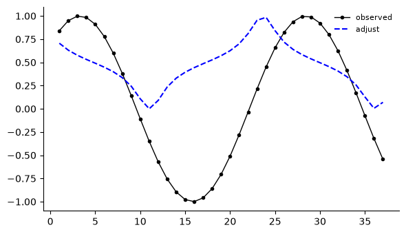

# Adaptive normalization -- asinh (`TsNormAn`, `operation="asinh"`)

**About the technique**

* The *asinh* operator of `TsNormAn` centers and scales each window and then applies the
  inverse hyperbolic sine, which compresses large magnitudes smoothly (like a signed log
  that is well defined at zero).

**Didactic goal:** damp heavy tails / spikes while keeping the transform invertible.


```python
import warnings
warnings.filterwarnings("ignore")

import pytspredit as ts

y = ts.datasets.tsd()["y"]
w = ts.ts_data(y, 5)
```

Visualize the series used in this example:


```python
_d = ts.datasets.tsd()
ts.plot_ts(x=_d["x"], y=_d["y"])
```


```python
norm = ts.TsNormAn(operation="asinh").fit(w)
t = norm.transform(w)
ts.ts_head(t)
```


             t4        t3        t2        t1        t0
    0  0.171275  0.362652  0.517860  0.630112  0.705826
    1  0.287920  0.419586  0.519259  0.588523  0.630915
    2  0.365463  0.455745  0.519809  0.559518  0.576605
    3  0.421439  0.482131  0.520046  0.536428  0.531910
    4  0.466945  0.504066  0.520131  0.515699  0.490610
    5  0.508412  0.524565  0.520109  0.494879  0.448021


```python
ts.ts_head(norm.inverse_transform(t))
```


             t4        t3        t2        t1        t0
    0  0.000000  0.247404  0.479426  0.681639  0.841471
    1  0.247404  0.479426  0.681639  0.841471  0.948985
    2  0.479426  0.681639  0.841471  0.948985  0.997495
    3  0.681639  0.841471  0.948985  0.997495  0.983986
    4  0.841471  0.948985  0.997495  0.983986  0.909297
    5  0.948985  0.997495  0.983986  0.909297  0.778073


Compare the original and normalized target (`t0`) columns (solid = original, dashed = normalized):


```python
ts.plot_ts_pred(y=w.iloc[:, -1].to_numpy(), yadj=t.iloc[:, -1].to_numpy())
```





> **What to observe.** Large values are compressed by `asinh`; `inverse_transform`
> (via `sinh`) recovers the original windows.

**References:** Ogasawara et al. (2010), *Adaptive Normalization*, IJCNN.
