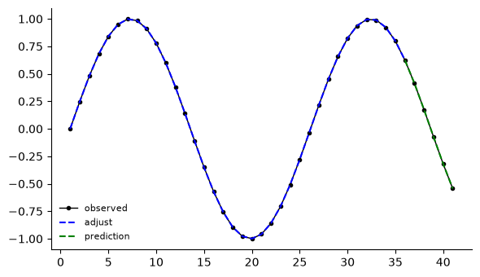

# ARIMA baseline (`TsArima`)

**About the technique**

* `TsArima` fits an ARIMA(p, d, q) on the raw series (built on `statsmodels`). Unlike the
  sliding-window regressors it extends `TsReg` and works on a `ts_data` with `sw = 1`.

**Didactic goal:** fit a user-specified ARIMA and forecast 5 steps ahead. (Automatic order
selection is shown in the ARIMA++ example.)


```python
import warnings
warnings.filterwarnings("ignore")

import pytspredit as ts

rser = ts.ts_data(ts.datasets.tsd()["y"], 1)
samp = ts.ts_sample(rser, test_size=5)
```


```python
model = ts.TsArima(p=2, d=0, q=0).fit(samp.train)   # explicit order -> fast
pred = model.predict(samp.test.iloc[[0]], steps_ahead=5)
model.evaluate(samp.test.to_numpy().ravel(), pred)["metrics"]
```


                mse   smape   R2
    0  6.630410e-10  0.0001  1.0


Plot the 5-step forecast against the observed series (solid = observed, dashed = forecast):


```python
y_all = ts.datasets.tsd()["y"].to_numpy()
ts.plot_ts_pred(y=y_all, yadj=y_all[:-5], ypred=pred)
```





> **What to observe.** An explicit `(p, d, q)` fits one model directly; for automatic
> order selection see `TsArima(auto="aicc")` and the ARIMA++ `auto="cv"` example.

**References:** Box, Jenkins, Reinsel & Ljung (2015), *Time Series Analysis: Forecasting
and Control*, Wiley.
