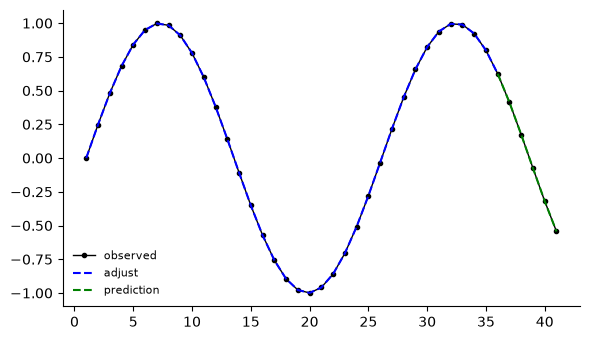

# DARIMA (`TsDarima`)

**About the technique**

* `TsDarima` is a linear model over the lag windows with differencing delegated to the preprocessor (native lm via _RLinear).
* A sliding-window regressor: preprocessing + lag map + backend, trained on the projected `(input, output)`.

**Didactic goal:** fit, forecast 5 steps ahead, and evaluate (MSE / sMAPE / R2).


```python
import warnings
warnings.filterwarnings("ignore")

import pytspredit as ts

w = ts.ts_data(ts.datasets.tsd()["y"], 6)
samp = ts.ts_sample(w, test_size=5)
tr, te = ts.ts_projection(samp.train), ts.ts_projection(samp.test)
```


```python
model = ts.TsDarima(ts.TsNormDiff(), input_size=5).fit(tr.input, tr.output)
pred = model.predict(te.input.iloc[[0]], steps_ahead=5)
model.evaluate(te.output.to_numpy().ravel(), pred)["metrics"]
```


                mse         smape   R2
    0  3.348299e-29  2.006428e-14  1.0


Plot the 5-step forecast against the observed series (solid = observed, dashed = forecast):


```python
y_all = ts.datasets.tsd()["y"].to_numpy()
ts.plot_ts_pred(y=y_all, yadj=y_all[:-5], ypred=pred)
```





> **What to observe.** `fit` learns on the training windows; `predict(steps_ahead=5)` rolls forward from the first test window; `evaluate` reports MSE/sMAPE/R2.

**References:** Salles, R. et al. (2017). A framework for benchmarking ML methods using linear models for univariate time series. IJCNN.
