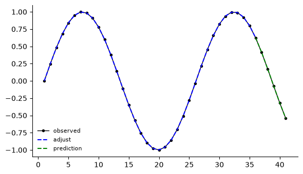

# ARIMA multi-step forecast

**Didactic goal:** Forecast several steps ahead directly from the fitted ARIMA.


```python
import warnings
warnings.filterwarnings("ignore")

import numpy as np
import pytspredit as ts

rser = ts.ts_data(ts.datasets.tsd()["y"], 1)
samp = ts.ts_sample(rser, test_size=5)
```


```python
model = ts.TsArima(p=2, d=0, q=0).fit(samp.train)
pred = model.predict(samp.test.iloc[[0]], steps_ahead=5)
model.evaluate(samp.test.to_numpy().ravel(), pred)["metrics"]
```


                mse   smape   R2
    0  6.630410e-10  0.0001  1.0


Plot the 5-step forecast against the observed series:


```python
y_all = ts.datasets.tsd()["y"].to_numpy()
ts.plot_ts_pred(y=y_all, yadj=y_all[:len(y_all) - len(pred)], ypred=pred)
```





> **What to observe.** A single multi-step forecast from the last training point.

**References:** Box, Jenkins, Reinsel & Ljung (2015), *Time Series Analysis*, Wiley.
