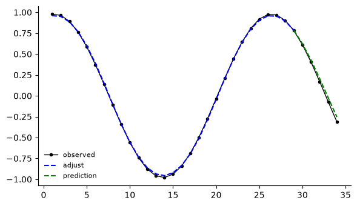

# MLP with a filter

**Didactic goal:** Clean the series with a filter before windowing and modeling.


```python
import warnings
warnings.filterwarnings("ignore")

import numpy as np
import pytspredit as ts

y = ts.datasets.tsd()["y"].to_numpy()
y = ts.TsFilMa(3).fit(y).transform(y)
y = y[~np.isnan(y)]
w = ts.ts_data(y, 6)
samp = ts.ts_sample(w, test_size=5)
tr, te = ts.ts_projection(samp.train), ts.ts_projection(samp.test)
out = te.output.to_numpy().ravel()
```


```python
model = ts.TsMlp(ts.TsNormGminmax(), input_size=5).fit(tr.input, tr.output)
model.evaluate(out, model.predict(te.input.iloc[[0]], steps_ahead=5))["metrics"]
```


            mse     smape        R2
    0  0.001522  0.287016  0.985955


Plot the 5-step forecast against the observed series:


```python
import numpy as np
pred = model.predict(te.input.iloc[[0]], steps_ahead=5)
adjust = np.asarray(model.predict(tr.input)).ravel()            # in-sample fit
yvalues = np.concatenate([tr.output.to_numpy().ravel(), te.output.to_numpy().ravel()])
ts.plot_ts_pred(y=yvalues, yadj=adjust, ypred=pred)
```





> **What to observe.** Filtering upstream can denoise the signal the model learns from.

**References:** Salles et al. (2023), *TSPredIT*, LNCS 14160.
