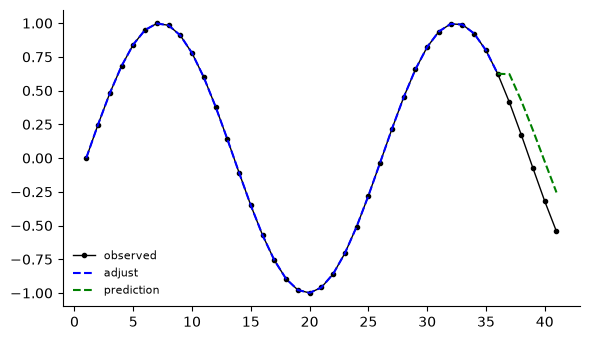

# Complete pipeline

**Didactic goal:** Filter + normalization + lag mapping + model in one flow.


```python
import warnings
warnings.filterwarnings("ignore")

import numpy as np
import pytspredit as ts

y = ts.datasets.tsd()["y"].to_numpy()
y = ts.TsFilMa(3).fit(y).transform(y); y = y[~np.isnan(y)]
w = ts.ts_data(y, 8)
samp = ts.ts_sample(w, test_size=5)
tr, te = ts.ts_projection(samp.train), ts.ts_projection(samp.test)
out = te.output.to_numpy().ravel()
```


```python
model = ts.TsMlp(ts.TsNormGminmax(), input_size=5, input_map=ts.TsLagmap("pacf")).fit(tr.input, tr.output)
model.evaluate(out, model.predict(te.input.iloc[[0]], steps_ahead=5))["metrics"]
```


            mse     smape        R2
    0  0.001504  0.284387  0.986121


Plot the 5-step forecast against the observed series:


```python
y_all = ts.datasets.tsd()["y"].to_numpy()
ts.plot_ts_pred(y=y_all, yadj=y_all[:-5], ypred=model.predict(te.input.iloc[[0]], steps_ahead=5))
```





> **What to observe.** The full preprocessing + lag-selection + model pipeline, end to end.

**References:** Salles et al. (2023), *TSPredIT*, LNCS 14160.
